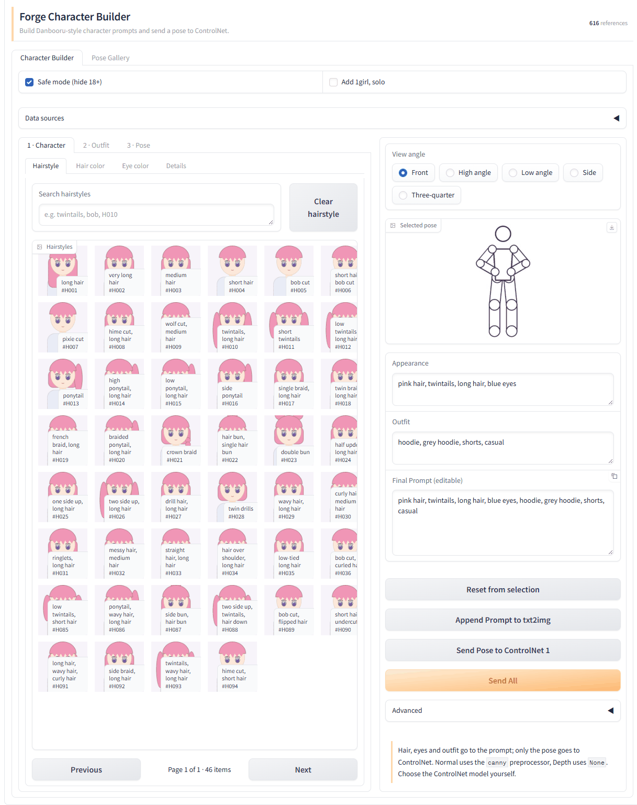
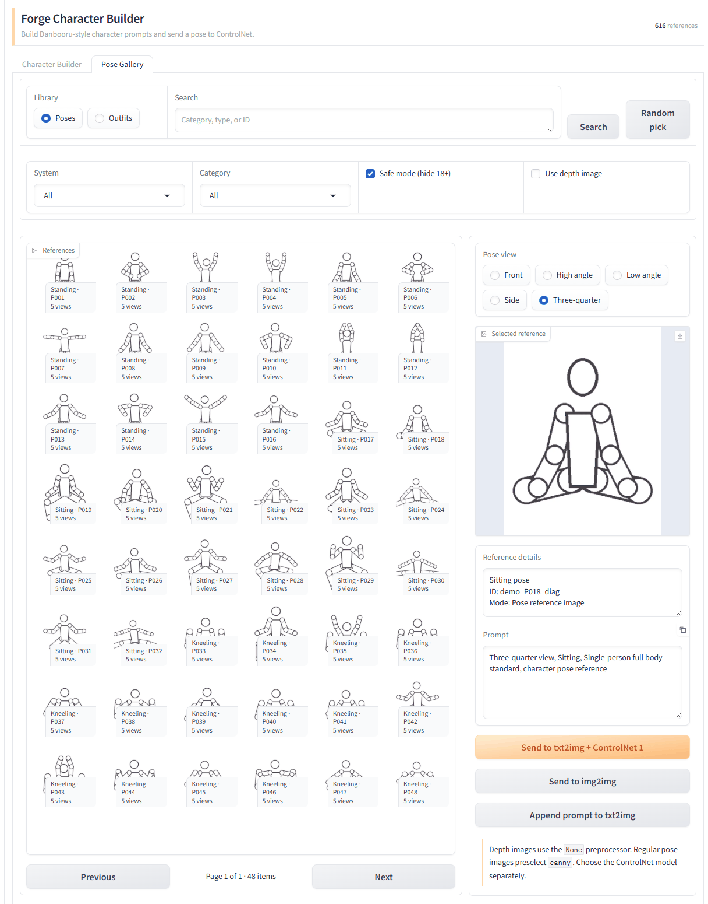

# Forge Character Builder

Forge Character Builder 是 [Forge Neo](https://github.com/Haoming02/sd-webui-forge-classic/tree/neo) 專用的角色 Prompt Builder 與姿勢圖庫擴充。

- 使用 [CharaDB](https://github.com/taki-ttt/charadb) 的 Danbooru tags 組合髮型、髮色、眼睛與服裝。
- 使用 [ai-pose-gallery-zh](https://github.com/anhao/ai-pose-gallery-zh) 的姿勢、服裝與人像素材。
- 將角色 Prompt 追加到既有的 txt2img Prompt，不會刪除原本的 Prompt、LoRA 或 Negative Prompt。
- 將姿勢圖送到 txt2img 的 ControlNet Unit 1，並自動切換到 txt2img 分頁。
- 同一姿勢的 4–5 個視角會合併為一張卡片，再由 View angle 切換。
- 上傳自己的姿勢圖到本機 Custom Poses 圖庫，同樣能送到 ControlNet。

目前版本：**1.6.0**

## 畫面

**Character Builder**：從圖片選擇髮型、髮色、眼睛、服裝與姿勢，右側即時組出 Final Prompt。



**Pose Gallery**：同一姿勢的多個視角合併為一張卡片，再以 Pose view 切換正面、俯視、仰視、側面與斜側。



> 截圖中的縮圖為自製示意圖。實際使用時會顯示 CharaDB 與 Anhao 的素材（需自行下載）。

## 系統需求

- Forge Neo（`sd-webui-forge-classic` 的 `neo` 分支）。
- Forge 內建的 ControlNet UI。若 ControlNet 無法載入，Copy／Append Prompt 仍可使用，但 Send Pose 與 Send All 會停用。
- 一套與目前 checkpoint 架構相容的 ControlNet 模型。下方範例 `xinsirControlnetCanny_v20` 是 **SDXL** 模型。
- CharaDB 與 Anhao 圖庫資料需自行安裝；外掛本身沒有額外的 pip 套件需求。

## 安裝外掛

在 Forge 的 `extensions` 目錄執行：

```powershell
git clone https://github.com/Horlicks-p/forge-character-builder.git
```

預期位置：

```text
Stable-diffusion-neo/
└─ extensions/
   └─ forge-character-builder/
```

完成下方資料安裝後重新啟動 Forge。上方分頁列會出現 **Character Builder**，內含 **Character Builder** 與 **Pose Gallery** 兩個子分頁。

## 必須自行下載的資料

### 1. Anhao 姿勢圖庫

下載或 clone [anhao/ai-pose-gallery-zh](https://github.com/anhao/ai-pose-gallery-zh)：

```powershell
git clone --depth 1 https://github.com/anhao/ai-pose-gallery-zh.git
```

推薦只把下列三個資料夾複製到此外掛的 `vendor/`：

```text
forge-character-builder/
└─ vendor/
   ├─ data/
   ├─ img/
   └─ thumbs/
```

不需要複製 Anhao 專案的 `src/`、`scripts/`、`node_modules/`、Cloudflare 設定或其他網站程式。

各功能需要的最少檔案如下：

| 功能 | 索引 | 圖片 |
|---|---|---|
| Pose Gallery／Character Builder Pose | `data/pose-zh.json` | `img/*.png`、`thumbs/*.jpg` |
| Pose 的 Depth 模式 | 同上 | `img/depth/*.webp`、`thumbs/depth/*.webp` |
| Anhao Outfit | `data/costume-zh.json` | `img/costume/*.webp`、`thumbs/costume/*.webp` |
| Portraits（預設隱藏） | `data/portrait-zh.json` | `img/portrait/*.webp`、`thumbs/portrait/*.webp` |

也可以不複製資料，改用環境變數指向完整的 Anhao repository：

```powershell
$env:ANHAO_GALLERY_ROOT = "D:\path\to\ai-pose-gallery-zh"
```

舊環境變數 `AI_POSE_GALLERY_ROOT` 仍可使用，但新安裝建議使用 `ANHAO_GALLERY_ROOT`。

### 2. CharaDB

Character Builder 的髮型、髮色、眼睛與二次元服裝來自 [taki-ttt/charadb](https://github.com/taki-ttt/charadb)。Git repository 只包含索引與程式，完整圖片包請從 [CharaDB Releases](https://github.com/taki-ttt/charadb/releases) 下載 `charadb_public.zip`。

把 ZIP 解壓到：

```text
forge-character-builder/
└─ vendor/
   └─ charadb/
      ├─ data.js
      ├─ thumb/
      ├─ img/
      └─ line/
```

外掛依序尋找：

1. `vendor/charadb/data/items_public.json`
2. `vendor/charadb/items_public.json`
3. `vendor/charadb/data.js`

只有索引而沒有圖片時仍能產生 Prompt，但卡片會顯示 no-preview。也可用環境變數指定資料位置：

```powershell
$env:CHARADB_ROOT = "D:\path\to\charadb_public"
```

CharaDB 未安裝時，Pose Gallery 仍可使用，Outfit 也能改選 Anhao (Original)；髮型、髮色與眼睛選項則不會出現。

### 完整目錄範例

```text
forge-character-builder/
├─ character_builder_core/
├─ character_builder_ui/
├─ javascript/
├─ scripts/
├─ vendor/
│  ├─ charadb/
│  │  ├─ data.js
│  │  ├─ thumb/
│  │  ├─ img/
│  │  └─ line/
│  ├─ data/
│  ├─ img/
│  └─ thumbs/
├─ metadata.ini
└─ style.css
```

## ControlNet：Canny 環境與模型

### 安裝 Canny 模型

一般姿勢圖會自動把 ControlNet Unit 1 的 Preprocessor 設成 `canny`，但外掛**不會代替使用者選擇模型**。

SDXL／Illustrious／Pony 類 checkpoint 可使用 Xinsir 的 Canny V2：

- 官方模型頁：[xinsir/controlnet-canny-sdxl-1.0](https://huggingface.co/xinsir/controlnet-canny-sdxl-1.0)
- V2 權重：[diffusion_pytorch_model_V2.safetensors](https://huggingface.co/xinsir/controlnet-canny-sdxl-1.0/blob/main/diffusion_pytorch_model_V2.safetensors)
- 常見的 Forge／Civitai 檔名：`xinsirControlnetCanny_v20.safetensors`

下載後可保留原檔名，或改名成較容易辨認的 `xinsirControlnetCanny_v20.safetensors`，放到：

```text
Stable-diffusion-neo/
└─ models/
   └─ ControlNet/
      └─ xinsirControlnetCanny_v20.safetensors
```

重新啟動 Forge，或在 ControlNet Model 旁按重新整理。若使用 `--controlnet-dir` 或 Forge 的額外 ControlNet model path，放入該自訂目錄也可以。

> `xinsirControlnetCanny_v20` 是 SDXL ControlNet，不能搭配 SD 1.5 checkpoint。使用 SD 1.5 時請另外安裝 SD 1.5 Canny 模型；模型架構必須與目前 checkpoint 相容。

### 建議設定

1. 在 Character Builder 選擇 Pose 與 View angle。
2. 保持 **Normal**，按 **Send Pose to ControlNet 1** 或 **Send All**。
3. 外掛會填入 ControlNet image、啟用 Unit 1、選擇 `canny`，並切換到 txt2img。
4. 在 ControlNet Model 手動選擇 `xinsirControlnetCanny_v20`。
5. 可從 Weight `0.7–1.0`、Starting Control Step `0`、Ending Control Step `1` 開始調整；構圖太僵硬時降低 Weight。

**Send All** 會先確認 Pose 成功送入 ControlNet，才把 Final Prompt 追加到 txt2img Prompt。它不會覆蓋原 Prompt。

### Depth 模式

Depth 圖已經是處理完成的控制圖，所以外掛會把 Preprocessor 設為 `None`。此時必須手動選擇與 checkpoint 架構相容的 **Depth ControlNet**；不要繼續使用 `xinsirControlnetCanny_v20`。

## 使用方式

### Character Builder

1. **Character**：用圖片卡片選擇 Hairstyle、Hair color、Eye color 與 Details。
2. **Outfit**：從 CharaDB (Anime) 或 Anhao (Original) 選擇服裝。
3. **Pose**：用 **Pose source** 選擇 Anhao 或 Custom Poses。Anhao 可再從右側 View angle 切換實際存在的 Front、High angle、Low angle、Side 或 Three-quarter 視角；Custom Poses 沒有視角與 Normal／Depth，會依儲存的 Input type 決定 Preprocessor。
4. 在右側檢查或修改 **Final Prompt (editable)**。
5. 使用 **Append Prompt to txt2img**、**Send Pose to ControlNet 1** 或 **Send All**。

### Pose Gallery

- 依 System、Category 與關鍵字篩選。
- 同一姿勢的多視角只顯示一張卡片，選取後再切換 Pose view。
- Normal 會使用 `canny`；Depth 會使用 `None`。
- 可單獨送往 txt2img + ControlNet 1、img2img，或只追加 Prompt。

### Custom Poses

把自己有權使用的姿勢圖上傳到本機圖庫，之後可在 **Pose Gallery** 與 Character Builder 的 **3 · Pose** 選用。

1. 開啟 **Pose Gallery**，Library 選 **Custom Poses**，按 **Add Pose**。
2. 選擇一張圖片，視需要填寫 Name、Prompt，選擇 Input type，再按 **Save Pose**。
3. 選取圖片後按 **Send to txt2img + ControlNet 1**。Model 不會被更動，請自行選擇符合圖片類型的 ControlNet 模型。

| Input type | Preprocessor | 適用圖片 |
|---|---|---|
| Pose reference (Canny) | `canny` | 一般姿勢參考圖 |
| Preprocessed Canny map | `None` | 已經是 Canny 線稿的圖 |
| OpenPose skeleton | `None` | OpenPose 骨架圖 |
| Depth map | `None` | 深度圖 |

- **Preprocessed Canny map 應為黑底白線**；白底黑線請先自行反相。
- 支援 PNG、JPEG、WebP 靜態圖，單檔上限 15 MiB、最多 2500 萬像素。長邊超過 2048 px 時會等比縮小；Canny 線稿縮小後細線可能變淡，建議使用長邊 2048 px 以內的原圖。
- **Prompt（選填）** 只在 Pose Gallery 選取時帶入 Prompt 欄位，在欄位內的修改只影響當次，要永久修改請用 **Edit details**。Character Builder 的 Final Prompt 不會帶入。
- **Mark as sensitive 是人工標記**：外掛不會自動辨識敏感圖片，Safe mode 只隱藏你標記過的項目。

#### 儲存位置與備份

圖庫預設存放在 `<Forge 資料目錄>/data/forge-character-builder/custom-poses`，內含 `images/`、`thumbs/`、`index.json` 與 `index.json.bak`。`Forge 資料目錄` 預設是 Forge 主程式資料夾，使用 `--data-dir` 時則是該資料夾；其下的 `data/` 是本外掛自己建立的資料夾，不是 Forge 規定的結構。

- 想換位置，請把環境變數 `FCB_CUSTOM_POSE_DIR` 設為可寫入的絕對路徑。
- Forge 的 Git 會把此資料夾顯示為 untracked，不影響 `git pull`。圖片只留在本機，請不要把它提交到公開的 repository。
- **備份方式是複製整個資料夾**；外掛不提供自動備份。
- **Delete 無法復原，也不是安全抹除**：Gradio、瀏覽器或作業系統的快取可能仍保留副本。

> **公開存取警告：** 使用 `--listen`、Tunnel 或 Colab 公開網址時，若沒有設定 `--gradio-auth`，任何取得網址的人都能新增、重新命名及刪除伺服器上的 Custom Poses，也可能讀取圖片。此功能不適合當作無驗證的多人共享服務。

### Settings

在 **Settings → Forge Character Builder** 可設定：

- **Show the Portraits library in the Pose Gallery tab**：顯示 Portraits，預設關閉。
- **Offer Anhao (Original) outfits as a Character Builder outfit source**：允許使用 Anhao 服裝，預設開啟。

變更後按 **Reload UI**。分頁上方的 **Data sources** 會顯示 CharaDB 與 Anhao 的狀態、項目數量及缺少的檔案。

## 常見問題

### Send Pose／Send All 是灰色的

- 尚未選擇 Pose；或
- Forge 的 ControlNet UI 沒有成功載入。請確認 txt2img 內有 ControlNet Unit，更新 Forge 後重新啟動。

### ControlNet 有圖片但沒有模型

模型檔不包含在此外掛內。把相容的 `.safetensors` 放入 `models/ControlNet/`，重新整理模型清單，並手動選擇模型。

### Data sources 顯示 Missing／Partial

展開 Data sources 查看缺少的路徑。最常見原因是 `vendor/data/pose-zh.json` 不存在，或只複製了 JSON、沒有複製 `img/` 與 `thumbs/`。

### Custom Poses 顯示 unavailable 或 read-only

unavailable 表示找不到可用的資料夾，請把 `FCB_CUSTOM_POSE_DIR` 設為可寫入的絕對路徑。read-only 表示 `index.json` 損壞或版本不符，外掛不會覆寫它；請依畫面訊息從 `index.json.bak` 還原。

### Prompt 會蓋掉我原本的內容嗎？

不會。Append 與 Send All 都是在 txt2img Prompt 尾端追加並自動處理逗號；既有 Prompt、LoRA 與 Negative Prompt 不會被清除。

## v1.6.0 重點

- 新增 **Custom Poses**：上傳自己的姿勢圖並永久保存，可搜尋、重新命名、刪除，再送到 ControlNet Unit 1。
- Character Builder 的 **3 · Pose** 可在 Anhao 與 Custom Poses 之間切換，沒有安裝 Anhao 也能使用 Custom Poses。
- 每張 Custom Pose 可選填 Prompt，在 Pose Gallery 選取時帶入。

## v1.5.2 重點

- 修正 Forge Neo 實機上 v1.5.1 的高度對齊沒有生效、分頁列下方留下大片空白的問題。
- 改由前端量測右欄高度後設定 Gallery 高度（420–1100 px），不受 Forge 自身 CSS 影響；沒有 Gallery 的分頁（Details）維持原高度。

## v1.5.1 重點

- 桌面版選擇 Gallery 會自動延展至右側 UI 高度，移除左欄下方空白。
- Character Builder 與 Pose Gallery 的分頁列會和右欄底部對齊。
- 窄螢幕仍保留原本的 Gallery 高度，避免行動版選擇區過長。

## v1.5.0 重點

- Character、Outfit、Pose 改為固定版面，不再因選取摘要出現而跳動。
- Hairstyle、Hair color、Eye color 與 Details 改為視覺化圖片選擇器。
- View angle 移至 Pose 預覽區，與 Pose Gallery 的操作位置一致。
- 同一姿勢的 4–5 個視角分組顯示。
- Send 完成後自動切換到目標 txt2img／img2img 分頁。
- Prompt 採追加模式，不覆蓋使用者原有內容。
- UI 僅顯示英文，並改用 Forge 主題的配色與簡潔頁首。
- 加強資料來源診斷、Safe mode 與過期選取項目的清理。

## 開發與測試

核心邏輯位於 `character_builder_core/`，UI 位於 `character_builder_ui/`。在 repository 根目錄執行：

```powershell
$env:PYTHONUTF8 = "1"
python -m unittest discover -s tests -v
```

要額外測試真實 CharaDB 索引，可先設定：

```powershell
$env:CHARADB_ITEMS = "D:\path\to\items_public.json"
```

## 素材與授權

- 本外掛的程式碼採用 [MIT License](LICENSE)。MIT 授權只涵蓋本 repository 的程式碼與文件，不涵蓋下列外部素材。
- 此 repository 不重新散布 CharaDB 或 Anhao 的圖片與資料；`tests/fixtures/charadb_sample.json` 只含少量 CharaDB 的 tags 與名稱（CharaDB 允許自由使用）。
- CharaDB 的程式、tags、名稱與圖片有不同的使用條款；圖片不可重新散布。請以 [CharaDB README](https://github.com/taki-ttt/charadb#readme) 為準。
- ai-pose-gallery-zh 的 MIT 授權只涵蓋其程式碼，不涵蓋 `img/`、`thumbs/` 與 `data/` 內的圖片和原始資料。請以 [ai-pose-gallery-zh README](https://github.com/anhao/ai-pose-gallery-zh#readme) 為準。
- Custom Poses 只接受你手動匯入的圖片，外掛不會從網路抓圖，也不提供分享功能。網路上公開的圖片不代表可以自由使用，請自行確認每張圖片的使用條件。
- Xinsir Canny 模型採用其模型頁所列的 Apache-2.0 授權。
